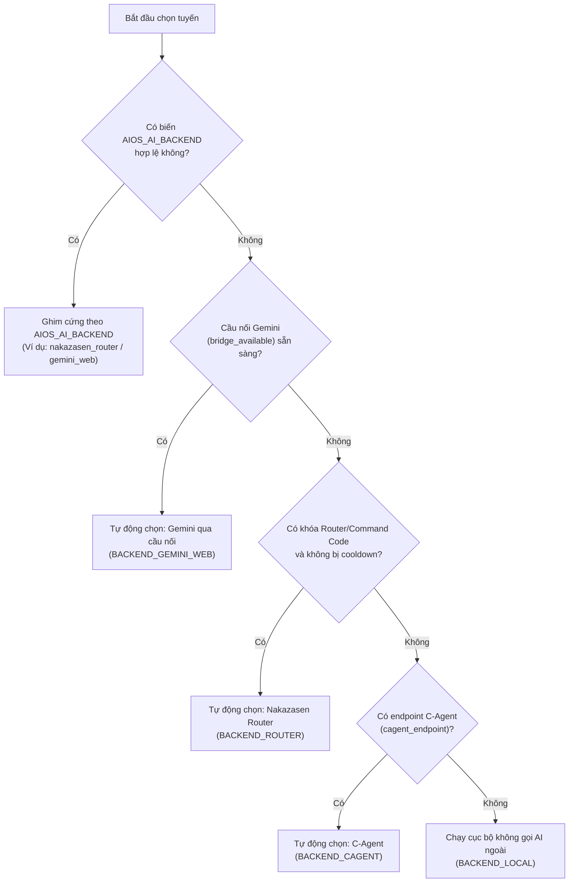

# HƯỚNG DẪN CẤU HÌNH VÀ VẬN HÀNH MÁY NHÀ (SETUP_MAY_NHA.md)

- **Trạng thái tài liệu**: `CHUẨN XÁC — ĐÃ ĐỐI CHIẾU SỰ THẬT TẠI MÁY VÀ MÃ NGUỒN`
- **Mã tài liệu**: `DOCS-HOME-SETUP-01`
- **Thời điểm chuẩn hóa**: 2026-10-22 (Sau các vé kiểm chứng `DESKTOP-HOME-COMMANDCODE-ROUTE-VERIFY` và `DESKTOP-HOME-DEFAULT-ROUTE-COMMANDCODE-2`)
- **Máy áp dụng**: Máy nhà (`H410ASROCK`), Windows 10 Pro 64-bit, CPU Intel Core i3-10100, RAM 16GB, GPU NVIDIA GeForce GTX 1060 3GB (Chế độ vận hành thường nhật: CPU-only).

---

## 1. BỐI CẢNH VÀ ĐÍNH CHÍNH LỆCH CẤU HÌNH (CONFIG DRIFT)

Trước ngày 22/10/2026, một số tài liệu dự thảo cũ từng mô tả cấu hình máy nhà sử dụng:
```ini
# CẤU HÌNH SAI LỆCH CŨ (KHÔNG CÒN HIỆU LỰC - KHÔNG CÓ TRONG RUNTIME):
AIOS_ANSWER_MODE=command_code
AIOS_COMMAND_CODE_MODEL=z-ai/glm-5.2
COMMANDCODE_API_KEY=<key>
```

Qua đợt kiểm chứng trực tiếp trên tệp `.env` thực tế và rà soát toàn diện mã nguồn tại vé `DESKTOP-HOME-COMMANDCODE-ROUTE-VERIFY` (đóng phiên 21:28 ngày 22/10/2026), dự án chính thức xác nhận:
1. **Ba biến môi trường trên hoàn toàn không tồn tại trong tệp `.env` thực tế của máy nhà**.
2. **Mã nguồn runtime không đọc các biến này để chọn tuyến hay gọi mô hình**.
3. Tuyến tổng hợp Command Code thực tế chạy hoàn toàn qua **họ biến `AIOS_LOCAL_AI_*`** (OpenAI-compatible endpoint).
4. Biến môi trường ghim tuyến trong mã nguồn là **`AIOS_AI_BACKEND`**, không phải `AIOS_ANSWER_MODE`.
5. Tài liệu này đóng vai trò là **nguồn sự thật duy nhất** về cấu hình máy nhà, dẹp bỏ hoàn toàn các mô tả lệch cấu hình cũ.

---

## 2. NGUỒN SỰ THẬT ĐƯỢC PHÊ DUYỆT

Mọi nội dung trong tài liệu này được đối chiếu trực tiếp từ các nguồn sự thật sau:
1. **Tệp `.env` thực tế tại máy nhà**: `D:\Sandbox\AIOS_habbit\.env` (kiểm chứng ngày 22/10/2026).
2. **Mã nguồn chọn tuyến**: `src/aios_habit/ai_lane.py` (hàm `select_ai_backend()`, `auto_backend_for_conversation()`).
3. **Mã nguồn cầu nối tổng hợp AI**: `src/aios_habit/ai_provider_bridge.py` (hàm `load_provider_config_from_env_or_session()`).
4. **Mã nguồn ứng dụng giao diện**: `src/aios_habit/workspace_chat_app.py`.
5. **Trình khởi chạy chính thức**: `RUN_AIOS_WORKSPACE_CHAT.bat`.
6. **Báo cáo kiểm chứng thực địa**: `hop-thu/lan-desktop/ket-qua/DESKTOP-HOME-COMMANDCODE-ROUTE-VERIFY.md`.

---

## 3. CƠ CHẾ CHỌN TUYẾN TRẢ LỜI MẶC ĐỊNH (AI LANE SELECTION)

Cơ chế lựa chọn tuyến AI được thực thi tại [ai_lane.py](file:///D:/Sandbox/AIOS_habbit/src/aios_habit/ai_lane.py) thông qua hàm `select_ai_backend()` với thứ tự ưu tiên tất định như sau:



### Chi tiết các tầng ưu tiên:
1. **Ghi đè cấu hình tay qua biến môi trường (`MANUAL_OVERRIDE_ENV = "AIOS_AI_BACKEND"`)**:
   - Nếu `AIOS_AI_BACKEND` được thiết lập một trong các giá trị: `nakazasen_router`, `gemini_web`, `cagent_api`, `local`, hệ thống lập tức chọn backend đó và đánh dấu `automatic = False`.
   - **Để đặt Command Code làm tuyến mặc định**: Đặt `AIOS_AI_BACKEND=nakazasen_router` trong `.env`. Khi đó hệ thống luôn dùng Command Code ngay cả khi tiến trình cầu nối Gemini đang chạy.
2. **Cầu nối Gemini (`BACKEND_GEMINI_WEB` - "Gemini qua cầu nối (tự động)")**:
   - Khi không có biến ghim tay `AIOS_AI_BACKEND`, nếu cờ `bridge_available = True`, hệ thống **ưu tiên số 1** chọn Gemini qua cầu nối.
   - Do trình khởi chạy `RUN_AIOS_WORKSPACE_CHAT.bat` tự động chạy nhúng tiến trình `antigravity_bridge`, cờ `bridge_available` luôn là `True` khi mở app bằng tệp bat này.
3. **Nakazasen Router / Command Code (`BACKEND_ROUTER` - "Nakazasen Router")**:
   - Tuyến này tự động được chọn khi:
     - `AIOS_AI_BACKEND=nakazasen_router` được cấu hình trong `.env`, HOẶC:
     - Cầu nối Gemini không khả dụng (hoặc tắt bridge) VÀ có khóa `AIOS_LOCAL_AI_API_KEY`.
4. **C-Agent (`BACKEND_CAGENT` - "C-Agent")**:
   - Chỉ khả dụng khi có `AIOS_CAGENT_API_URL`. Máy nhà không có biến này vì C-Agent thuộc mạng nội bộ công ty.
5. **Cục bộ (`BACKEND_LOCAL` - "Chạy cục bộ (không gọi AI ngoài)")**:
   - Tuyến dự phòng an toàn tuyệt đối khi không có AI ngoài nào khả dụng.

---

## 4. HỌ BIẾN MÔI TRƯỜNG TUYẾN COMMAND CODE (`AIOS_LOCAL_AI_*`)

Cấu hình chi tiết cho tuyến Command Code tại máy nhà được đặt trong tệp `.env` tại thư mục gốc repository (`D:\Sandbox\AIOS_habbit\.env`):

| Tên biến môi trường | Giá trị cấu hình thực tế tại máy nhà | Ý nghĩa và vai trò | Tệp mã nguồn đọc biến |
| :--- | :--- | :--- | :--- |
| `AIOS_AI_BACKEND` | `nakazasen_router` | Ghim tuyến tổng hợp mặc định sang Command Code router | `src/aios_habit/ai_lane.py`<br>`src/aios_habit/workspace_chat_app.py` |
| `AIOS_LOCAL_AI_ENDPOINT` | `https://api.commandcode.ai/provider/v1/chat/completions` | Endpoint gọi API tương thích chuẩn OpenAI của Command Code | `src/aios_habit/ai_provider_bridge.py` |
| `AIOS_LOCAL_AI_MODEL` | `reflection/beam:free` | Model chính (Tier 1) trong pool miễn phí của Command Code | `src/aios_habit/ai_provider_bridge.py`<br>`src/aios_habit/workspace_chat_app.py` |
| `AIOS_LOCAL_AI_FAILOVER_MODELS` | `poolside/laguna-s-2.1-free,stealth/glyph-cluster:free` | Danh sách model dự phòng (Tier 2 & 3) tự động failover khi model chính lỗi/bận | `src/aios_habit/workspace_chat_app.py` |
| `AIOS_LOCAL_AI_API_KEY` | *(Khóa hợp lệ độ dài 93 ký tự — bảo mật)* | Khóa xác thực API của nhà cung cấp Command Code | `src/aios_habit/ai_provider_bridge.py` |
| `AIOS_LOCAL_AI_LOCALITY` | `cloud` | Xác định vùng thực thi là dịch vụ đám mây (cloud) | `src/aios_habit/ai_provider_bridge.py` |
| `AIOS_LOCAL_AI_TIMEOUT_SECONDS` | `90` | Thời gian chờ tối đa cho mỗi lượt gọi mô hình (giây) | `src/aios_habit/ai_provider_bridge.py`<br>`src/aios_habit/workspace_chat_app.py` |
| `AIOS_SYNTHESIS_ALLOW_CLOUD_PROVIDERS` | `1` | Cho phép bộ tổng hợp RAG gọi ra các provider cloud | `src/aios_habit/workspace_chat_app.py` |

> [!NOTE]
> Danh mục model miễn phí (`:free`) trên Command Code có thể được nhà cung cấp luân chuyển theo thời gian. Khi một model bị hạ khỏi endpoint (ví dụ `stealth/cat-jam:free` đã hạ ngày 22/10/2026), cấu hình model cần được cập nhật theo danh mục `/models` còn sống (`reflection/beam:free`, `poolside/laguna-s-2.1-free`, `stealth/glyph-cluster:free`).

---

## 5. LÀM RÕ VAI TRÒ CỦA `AIOS_ANSWER_MODE` VÀ LỚP `llm_settings`

### Rà soát biến `AIOS_ANSWER_MODE`:
- **Trong mã nguồn runtime**: Biến `AIOS_ANSWER_MODE` **hoàn toàn không được tham chiếu hoặc đọc** bởi bất kỳ tệp Python nào trong thư mục `src/aios_habit/`.
- **Đánh giá hiệu lực**: `AIOS_ANSWER_MODE` là biến tàn dư từ các tài liệu ý niệm ban đầu. Trong mã nguồn thực tế, logic chọn tuyến chỉ đọc biến `AIOS_AI_BACKEND` (quy định tại dòng 40 của `src/aios_habit/ai_lane.py`).
- **Quy tắc vận hành**: Đánh dấu **KHÔNG CÒN HIỆU LỰC (DEPRECATED / OBSOLETE)**. Không thiết lập hoặc dựa vào biến này.

### Rà soát tệp `llm_settings.py`:
- **Hiện trạng tồn tại**: Tệp `src/aios_habit/llm_settings.py` **không tồn tại** trong repository.
- **Mã nguồn thực tế tương đương**:
  - `src/aios_habit/llm_client.py`: Lớp client LLM chung (`load_llm_config()`), đọc họ biến `AIOS_LLM_*` (`AIOS_LLM_PROVIDER`, `AIOS_LLM_BASE_URL`, `AIOS_LLM_API_KEY`, `AIOS_LLM_MODEL`). Lớp này dùng cho các tác vụ client chung, không phải tuyến tổng hợp của Workspace Chat.
  - `src/aios_habit/ai_provider_bridge.py`: Mô-đun thực tế chịu trách nhiệm nạp cấu hình và thực thi tổng hợp câu trả lời cho Workspace Chat (`load_provider_config_from_env_or_session()`), đọc họ biến `AIOS_LOCAL_AI_*`.

---

## 6. BẢNG SỰ THẬT CẤU HÌNH THEO MÁY (HOME VS COMPANY)

Bảng đối chiếu sự thật cấu hình giữa Máy nhà và Máy công ty:

| Hạng mục cấu hình | Máy nhà (`H410ASROCK`) | Máy công ty (`PC0575`) | Nguồn sự thật đối chiếu |
| :--- | :--- | :--- | :--- |
| **Tuyến trả lời mặc định** | `nakazasen_router` (Command Code qua Router)<br>*(hoặc `gemini_web` khi bỏ ghim và bridge bật)* | `cagent_api` (C-Agent nội bộ công ty) | - Máy nhà: `.env` dòng `AIOS_AI_BACKEND`<br>- Máy công ty: `docs/phieu-viec/ket-qua/DESKTOP-PC0575-CAGENT-RECONNECT-TERRA.md:82`<br>- Mã nguồn: `src/aios_habit/ai_lane.py:40-86` |
| **Chuỗi Model cấu hình ở đâu** | Đặt trong `.env` qua 2 biến:<br>- Chính: `AIOS_LOCAL_AI_MODEL`<br>- Dự phòng: `AIOS_LOCAL_AI_FAILOVER_MODELS` | Được cấu hình sẵn phía máy chủ Flowise của C-Agent (`gpt 5.6 terra`) kết hợp prompt template | - Máy nhà: `.env` máy nhà; `src/aios_habit/ai_provider_bridge.py:199`<br>- Máy công ty: `src/aios_habit/cagent_api.py:68` |
| **Giá trị Model hiện hành** | Model chính: `reflection/beam:free`<br>Dự phòng: `poolside/laguna-s-2.1-free`, `stealth/glyph-cluster:free` | Model phía C-Agent Flowise: `gpt 5.6 terra` | - Máy nhà: `.env` máy nhà (vé `DESKTOP-HOME-DEFAULT-ROUTE-COMMANDCODE-2`)<br>- Máy công ty: Báo cáo `DESKTOP-PC0575-CAGENT-RECONNECT-TERRA.md` |
| **Khóa API (API Key) nằm ở đâu** | Đặt trong `.env` qua biến `AIOS_LOCAL_AI_API_KEY` (khóa 93 ký tự riêng của máy nhà) | Được quản lý qua `AIOS_CAGENT_ACCESS_TOKEN` / `AIOS_CAGENT_TOKEN` hoặc xác thực header Flowise | - Máy nhà: `.env` máy nhà; `src/aios_habit/ai_provider_bridge.py:203`<br>- Máy công ty: `src/aios_habit/cagent_auth.py:48-62` |
| **Địa chỉ Endpoint dịch vụ** | `https://api.commandcode.ai/provider/v1/chat/completions` | `AIOS_CAGENT_API_URL` (`https://kdtvn-ai.cmcts.vn/api/v1/prediction/...`) | - Máy nhà: `.env` máy nhà; `src/aios_habit/ai_provider_bridge.py:195`<br>- Máy công ty: `docs/phieu-viec/ket-qua/DESKTOP-PC0575-CAGENT-RECONNECT-TERRA.md:83` |
| **Thời gian chờ (Timeout)** | 90 giây (`AIOS_LOCAL_AI_TIMEOUT_SECONDS=90`) | 60 giây (`AIOS_CAGENT_TIMEOUT_SECONDS=60`) | - Máy nhà: `.env` máy nhà; `src/aios_habit/ai_provider_bridge.py:142`<br>- Máy công ty: `src/aios_habit/cagent_api.py:32` |
| **Trình khởi chạy chính thức** | `RUN_AIOS_WORKSPACE_CHAT.bat` | `RUN_AIOS_WORKSPACE_CHAT.bat` (kèm cấu hình riêng của PC0575) | - Gốc repo: `RUN_AIOS_WORKSPACE_CHAT.bat:54-64` |
| **Tiến trình phụ trợ tự bật** | `antigravity_bridge` (khởi chạy ngầm ở port 8765) | Không dùng bridge Gemini | - Máy nhà: `RUN_AIOS_WORKSPACE_CHAT.bat:92-94` |

---

## 7. QUY TRÌNH KHỞI ĐỘNG VÀ VẬN HÀNH CHUẨN TRÊN MÁY NHÀ

1. **Chuẩn bị tệp `.env`**:
   Sao chép từ `.env.example` sang `.env` nếu thiết lập môi trường mới:
   ```powershell
   Copy-Item .env.example .env
   ```
   Điền khóa `AIOS_LOCAL_AI_API_KEY` của bạn vào tệp `.env`.

2. **Khởi chạy ứng dụng**:
   Chạy tệp batch chuẩn tại thư mục gốc:
   ```cmd
   RUN_AIOS_WORKSPACE_CHAT.bat
   ```
   Trình khởi chạy sẽ tự động:
   - Kiểm tra và kích hoạt thư viện RAG (`torch`, `FlagEmbedding`).
   - Khởi động tiến trình ngầm `antigravity_bridge`.
   - Nạp các biến môi trường từ `.env`.
   - Khởi chạy ứng dụng Streamlit tại `http://localhost:8501`.

3. **Kiểm tra trạng thái tuyến trả lời trên giao diện**:
   - Khi `AIOS_AI_BACKEND=nakazasen_router`: Footer sẽ hiển thị:
     `Đang dùng: Nakazasen Router (ghim tay). Giữ theo cấu hình tay AIOS_AI_BACKEND.`
   - Nút tuyến trên Toolbar sẽ hiển thị: `🌐 Command Code`.
   - Người dùng vẫn có thể bấm nút Toolbar để chuyển thủ công sang `🌉 Gemini` hoặc `💻 Cục bộ` cho từng cuộc hội thoại khi cần thiết.
