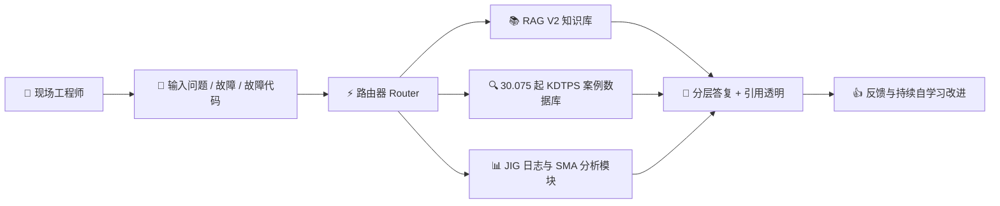

# AIOS 台账综合使用手册
## 故障调查与智能生产监控辅助系统

> **适用对象:** 现场工程师、生产班组长、维修技术人员及质量管理部门(主要用户:Vinh)。  
> **版本:** AIOS 台账桌面版 v2.5(支持台式电脑及移动设备)。  
> **更新时间:** 2026-10-23。  
> **设计方针:** *"快速 — 准确 — 来源透明 — 数据安全"*。

---

## 总目录

- [1. 综合介绍与作业流程](#1-综合介绍与作业流程)
- [2. 第1部分:A组 — 发送通道与聊天框](#第1部分a组--发送通道与聊天框)
  - [A1. 发送问题与防重复发送机制(Idempotency)](#a1-发送问题与防重复发送机制idempotency)
  - [A2. 在 worker 加载期间点击快捷建议 chip](#a2-在-worker-加载期间点击快捷建议-chip)
  - [A3. 打开冷台账后等待:自动解锁并保留问题](#a3-打开冷台账后等待自动解锁并保留问题)
  - [A4. 按真人节奏输入陷阱(Human Cadence)](#a4-按真人节奏输入陷阱human-cadence)
  - [A5. 诚实的三步等待卡片](#a5-诚实的三步等待卡片)
- [3. 第2部分:B组 — 按库问答与标准数据查询](#第2部分b组--按库问答与标准数据查询)
  - [B1. 在 4 个专业知识库上作业](#b1-在-4-个专业知识库上作业)
  - [B2. 结构化数据查询(与 Ground Truth 对照)](#b2-结构化数据查询与-ground-truth-对照)
  - [B3. 相似故障查询与标准标签"Vụ"](#b3-相似故障查询与标准标签vụ)
  - [B4. 按时间窗口与机型扩展查询](#b4-按时间窗口与机型扩展查询)
  - [B5. 技术答复的纯越南语规范化](#b5-技术答复的纯越南语规范化)
- [4. 第3部分:C组 — 故障调查业务第1步至第5步](#第3部分c组--故障调查业务第1步至第5步)
  - [C1. 面向新人的分层故障调查指南(第3步)](#c1-面向新人的分层故障调查指南第3步)
  - [C2. JIG/LSU 日志分析与 SMA(20) 趋势预警卡片](#c2-jiglsu-日志分析与-sma20-趋势预警卡片)
  - [C3. 直接在聊天框中生成定期趋势报告](#c3-直接在聊天框中生成定期趋势报告)
  - [C4. 自动分类与第5步复发预警卡片(C7620)](#c4-自动分类与第5步复发预警卡片c7620)
- [5. 第4部分:D组 — 反馈评价与习惯自学习](#第4部分d组--反馈评价与习惯自学习)
  - [D1. 点赞/点踩评价与 4 项理由选择面板](#d1-点赞点踩评价与-4-项理由选择面板)
  - [D2. 三段式专家队列与 PIN 安全验证点](#d2-三段式专家队列与-pin-安全验证点)
  - [D3. 草稿来源层(标签:草稿 — 未经核验)](#d3-草稿来源层标签草稿--未经核验)
  - [D4. 习惯自学习管理面板(Master Switch 与删除档案)](#d4-习惯自学习管理面板master-switch-与删除档案)
- [6. 第5部分:E组 — 智能搜索与显示模式](#第5部分e组--智能搜索与显示模式)
  - [E1. 遇到数据范围外问题时的 5 级答复阶梯](#e1-遇到数据范围外问题时的-5-级答复阶梯)
  - [E2. 安全的外部 AI 提问模式(保护机密数据)](#e2-安全的外部-ai-提问模式保护机密数据)
  - [E3. 原始文档引用查看器(Source Viewer)](#e3-原始文档引用查看器source-viewer)
  - [E4. 答复逐字流式显示(Streaming)](#e4-答复逐字流式显示streaming)
  - [E5. 在工具栏切换 3 种搜索模式](#e5-在工具栏切换-3-种搜索模式)
  - [E6. Command Code 处理线路与 C-Agent 连接监控](#e6-command-code-处理线路与-c-agent-连接监控)
- [7. 第6部分:F组 — 台账与会话管理](#第6部分f组--台账与会话管理)
  - [F1. 新建台账、新建会话与多台账切换](#f1-新建台账新建会话与多台账切换)
  - [F2. 重新打开旧会话并延续思路](#f2-重新打开旧会话并延续思路)
- [8. 第7部分:G组 — 高级扩展功能(G1 至 G18)](#第7部分g组--高级扩展功能g1-至-g18)
  - [G1. 多格式附件与最大 64MB 大文件 OCR](#g1-多格式附件与最大-64mb-大文件-ocr)
  - [G2. 从聊天界面新建故障调查案例](#g2-从聊天界面新建故障调查案例)
  - [G3. 向各库导入新文档与就绪探测标签](#g3-向各库导入新文档与就绪探测标签)
  - [G4. 导入扫描文档与技术图纸时的 Indra OCR](#g4-导入扫描文档与技术图纸时的-indra-ocr)
  - [G5. LSU 专家访谈与知识入库整合](#g5-lsu-专家访谈与知识入库整合)
  - [G6. 桌面端日志图表构建器(Log Chart Builder)](#g6-桌面端日志图表构建器log-chart-builder)
  - [G7. LSU 实时预警与 RT 追溯卡片(Trace Link)](#g7-lsu-实时预警与-rt-追溯卡片trace-link)
  - [G8. 按机型、序列号与日期范围筛选故障](#g8-按机型序列号与日期范围筛选故障)
  - [G9. 按技术文档名称点名提问](#g9-按技术文档名称点名提问)
  - [G10. 知识块选择器与优先通道置顶功能](#g10-知识块选择器与优先通道置顶功能)
  - [G11. 在答复内直接追问与防重复显示](#g11-在答复内直接追问与防重复显示)
  - [G12. 显示来源名称、标准日期与 Source Viewer](#g12-显示来源名称标准日期与-source-viewer)
  - [G13. 刷新或切换页面时草稿框持久保存机制](#g13-刷新或切换页面时草稿框持久保存机制)
  - [G14. 查看外部 AI 使用日志及耗时测量](#g14-查看外部-ai-使用日志及耗时测量)
  - [G15. 专家评审集中层与聊天命令 xem phản hồi](#g15-专家评审集中层与聊天命令-xem-phản-hồi)
  - [G16. 会话后自学习与 Curator 技能库](#g16-会话后自学习与-curator-技能库)
  - [G17. 含故障代码的问题自动路由至故障案例数据库](#g17-含故障代码的问题自动路由至故障案例数据库)
  - [G18. 30.075 起合并数据库的运行与配置切换机制](#g18-30075-起合并数据库的运行与配置切换机制)
- [8. 附录: 核心操作快速查询表](#8-附录-核心操作快速查询表)
- [9. 系统命令目录（斜杠命令 Slash Commands）](#9-系统命令目录斜杠命令-slash-commands)

---

## 1. 综合介绍与作业流程

**AIOS 台账**系统是专为工业打印设备制造与生产环境打造的人工智能助理平台。系统整合了全部历史故障数据(30.075 起 KDTPS 案例)、机型技术档案(Iris、Virgo、6th Next、Libra……)、MES/Opcenter 运行日志以及 LSU 光学工序的校准测量记录。

---

## 第1部分:A组 — 发送通道与聊天框

### A1. 发送问题与防重复发送机制(Idempotency)
- **目的:** 确保在发送问题后长时间放手等待($\ge 60$ 秒)时,系统仅记录唯一的 1 轮问答,不会重复发送,也不会出现界面卡死。
- **操作:** 输入问题 *"复印机定期保养包括哪些步骤?"*(越南语原文:*"Bảo dưỡng máy in photocopy định kỳ gồm những bước nào?"*),点击"发送"后放手不做任何操作,等待 65 秒。
- **实际证据:** 界面准确接收 1 轮问答,并生成完整的答复。

---

### A2. 在 worker 加载期间点击快捷建议 chip
- **目的:** 帮助工程师在打开冷台账时立即点击建议问题,而不会丢失指令;worker 加载完成后会立即作答。
- **操作:** 打开冷台账 `NB-LAZY-MOM`,在系统预热(warm-up)期间立即点击第一个建议 chip。
- **实际证据:** 问题被完整保留,并在 worker 就绪后立即得到完整答复。

---

### A3. 打开冷台账后等待:自动解锁并保留问题
- **目的:** 100% 保护已输入的内容。worker 加载完成后,"发送"按钮自动解锁,且不会丢失文字。
- **操作:** 打开台账 `NB-LAZY-LSU`,在 worker 加载完成之前先将问题输入文本框(textarea)。
- **实际证据:** "发送"按钮自动亮起,问题被完整保留。

---

### A4. 按真人节奏输入陷阱(Human Cadence)
- **目的:** 工程师边输入边停顿思考时,系统不会仓促发送,也不会陷入假等待循环(*false loop*)。
- **操作:** 以每字符 22ms 的自然延迟输入问题,中途停手 2.5 秒,然后点击"发送"。
- **实际证据:** 系统完整接收了完整的问题。

---

### A5. 诚实的三步等待卡片
- **目的:** 通过 3 个独立步骤完全透明地展示处理过程:`1. 查找来源` $\rightarrow$ `2. 分析数据` $\rightarrow$ `3. 撰写答复`。
- **操作:** 在 AI 开始处理请求时观察进度条。
- **实际证据:** 每个步骤分别显示各自的实际耗时,不会跳步直接到第 3 步。

---

## 第2部分:B组 — 按库问答与标准数据查询

### B1. 在 4 个专业知识库上作业
系统划分为 4 个独立的知识库,以避免数据混淆:
1. **LSU 库(`NB-LAZY-LSU`):** 厚度 40μm 的 SIM tape MIRROR C 粘贴规范、Jig 校准。
2. **故障调查库(`NB-LAZY-DTL`):** 30.075 起 KDTPS 故障案例、SC 故障代码、JAM 卡纸。
3. **MOM/Opcenter 库(`NB-LAZY-MOM`):** 紧急停机流程、MES 调度协同。
4. **综合知识库(`NB-C26E1C84`):** 定期保养手册、5S 标准规范。

---

### B2. 结构化数据查询(与 Ground Truth 对照)
对照全厂数据库中已核准的数据基准:
- **C7620 复发:** 标准 **136 起**(最新一起为 2026年10月15日的 `FY27H2/263` 起)。
- **C6770:** 标准 **33 起**。
- **2025 年的 C7620:** 标准 **60 起**。
- **JAM4212:**
  - **结构化统计路径(命令 `Tra cứu mã lỗi JAM4212`,意为"查询故障代码 JAM4212"):** 清晰显示 **24 起**直接匹配标准故障代码列(`error_code_i`、`error_code_h`、`error_code_c`)。
  - **相似查询 / 扩展路径:** 按最终确认的 ground-truth,去除噪声后的实际相关总数为 **63 起**。

---

### B3. 相似故障查询与标准标签"Vụ"
- **目的:** 将故障的计量单位统一为 **"起"**(越南语界面显示为 **"Vụ"**,取代旧术语 "Phiếu"),并附带注册编号来源 `History KDTPS.xlsx` 的说明。
- **操作:** 输入与卡纸相关的故障案例查询,核对界面显示的标签。

---

### B4. 按时间窗口与机型扩展查询
按各生产批次圈定故障分析范围:
1. **Virgo 2023年8–10月 x Postcard 偏移:** 标准 **11 起**。
2. **Virgo 2023年第4季度 x Postcard 偏移:** 标准 **12 起**。
3. **6th Next 2023年1月 x 屏幕白屏:** 标准 **1 起**(`2023/38` 起)。
4. **Iris 相同现象:** 提示 **0 起**,同时建议工程师参考同等机型 Virgo 的查询结果。

---

### B5. 技术答复的纯越南语规范化
- **目的:** 在 4 条主要答复路径(综合、相似查询、结构化、草稿)上,答复正文 100% 使用规范的技术越南语(带声调符号),不再出现未翻译的日文原文(词语 `不要` 已被完整译为 "Không cần đối sách bổ sung / Đã xử lý tại chỗ không cần đối sách chính thức",意为"无需追加对策 / 已在现场处理,无需正式对策")。
- **核查故障代码 JAM4212 的词典定义:** 在综合/相似答复中,第 1 项(技术定义)已 100% 完整译为越南语:*"Kẹt giấy tại cảm biến sấy (Cấp giấy khay 2)"*(意为"定影传感器处卡纸(纸盒 2 供纸)"),机理为 *"Đã qua thời gian quy định từ khi cảm biến phát hiện cuốn giấy trung gian ngắt (OFF) nhưng cảm biến sấy vẫn chưa ngắt (OFF)"*(意为"自传感器检测到中间转印纸卷断开(OFF)起已超过规定时间,但定影传感器仍未断开(OFF)")。
- **4 条纯越南语规范化答复路径:**
  1. *综合路径:* 复印机定期保养流程 5 个步骤,清晰的纯越南语表述。
  2. *相似查询路径:* 答复正文中的故障代码词典定义 100% 完整译为越南语。
  3. *结构化路径:* 2025 年 C7620 显示 60 起,处理术语翻译干净。
  4. *草稿路径:* MOM/Opcenter 库的纯越南语答复,附技术推断警告卡片。

---

## 第3部分:C组 — 故障调查业务第1步至第5步

### C1. 面向新人的分层故障调查指南(第3步)
- **目的:** 提供结构化的分步调查流程(安全 $\rightarrow$ 现场 $\rightarrow$ 机械 $\rightarrow$ 传感器 $\rightarrow$ 电路板),帮助新人能够先行初步处理。
- **操作:** 输入 *"gợi ý hướng điều tra máy in bị kẹt giấy trước cụm sấy, cơ cấu áp sấy không quay..."*(意为"请给出调查方向:打印机在定影单元前卡纸,定影加压机构不转动……";其中 `gợi ý hướng điều tra cho <hiện tượng>` 为应用内的调用句式,意为"请为<现象>给出调查方向建议")。

---

### C2. JIG/LSU 日志分析与 SMA(20) 趋势预警卡片
- **目的:** 导入大型生产日志文件(30.87MB),当出现 $\ge 3$ 个连续坏点超过 $2.5\sigma$ 时,系统按 SMA(20) 规则自动检测异常趋势。
- **操作:** 上传日志 `2025_02.csv`,观察参数 `MeasureFieldCurvatureYellow` 的预警。

---

### C3. 直接在聊天框中生成定期趋势报告
- **目的:** 直接在对话流中发布质量综合报告、按产线分布的故障率。
- **操作:** 输入 *"Báo cáo xu hướng định kỳ"*(应用命令,意为"定期趋势报告")。

---

### C4. 自动分类与第5步复发预警卡片(C7620)
- **目的:** 对于复发风险高的故障,系统自动附加醒目的橙色 **第5步复发预警卡片**,提供历史统计数据与已验证的对策。
- **操作:** 输入建案命令:*"Tạo vụ điều tra lỗi mới: kẹt giấy cụm sấy lỗi C7620"*(应用命令,意为"新建故障调查案:定影单元卡纸,故障 C7620")。
- **结果:** 复发预警卡片清晰显示:*复发:代码 C7620 已在历史数据库(30.075 起)中出现 136 次。最近一起:`FY27H2/263` 起*。

---

## 第4部分:D组 — 反馈评价与习惯自学习

### D1. 点赞/点踩评价与 4 项理由选择面板
- **目的:** 记录工程师的评价以改进 AI 质量。点击"点踩"(Thumbs Down)时,弹窗显示 4 个标准理由(*Sai* 错误、*Khó hiểu* 难以理解、*Thiếu nguồn* 缺少来源、*Lạc đề* 跑题),并附说明输入框。

---

### D2. 三段式专家队列与 PIN 安全验证点
- **目的:** 管理等待专家审核进入正式库的新知识提案。流程准确停在服务器 PIN 安全码验证点。

---

### D3. 草稿来源层(标签:草稿 — 未经核验)
- **目的:** 使用未经审核的草稿数据生成的答复会被贴上清晰的警告标签,同时知识库绝对隔离,不会交叉泄露到其他台账。

---

### D4. 习惯自学习管理面板(Master Switch 与删除档案)
- **目的:** 允许用户在侧边栏开启/关闭自学习总开关(Master Switch),并安全管理个人习惯档案。

---

## 第5部分:E组 — 智能搜索与显示模式

### E1. 遇到数据范围外问题时的 5 级答复阶梯
- **目的:** 当问题超出工厂文档范围时,AIOS 不会粗暴拒绝,而是启动 Tier 4 阶梯,给出推断性判断,并附 3 个 Tier 5 行动按钮(*Dạy AIOS* 教 AIOS、*Hỏi chuyên gia* 咨询专家、*Hỏi AI ngoài* 问外部 AI)。

---

### E2. 安全的外部 AI 提问模式(保护机密数据)
- **目的:** 当需要从互联网查询通用技术知识时,该模式仅发送问题和对话历史,绝不将内部机密文档发送到外部。

---

### E3. 原始文档引用查看器(Source Viewer)
- **目的:** 点击答复中的文档引用卡片,即可打开面板查看定义、原因、对策的原文,并下载原始文档。

---

### E4. 答复逐字流式显示(Streaming)
- **目的:** 文字按答复生成的节奏顺畅地逐字呈现,并附状态卡片,帮助用户持续跟踪内容,无需长时间等待。

---

### E5. 在工具栏切换 3 种搜索模式
- **目的:** 工具栏上的 `⚡` 按钮可快速切换 3 种搜索模式:**自动**、**快速搜索**和**按事实搜索**。

---

### E6. Command Code 处理线路与 C-Agent 连接监控
- **目的:** 默认运行线路为 Command Code(Router),带 failover 故障转移备用链;C-Agent 状态点按家庭机器的内部网络情况准确显示为红色。

---

## 第6部分:F组 — 台账与会话管理

### F1. 新建台账、新建会话与多台账切换
- **目的:** 在热台账(LSU、故障调查)与冷台账(MOM、综合)之间流畅操作。`➕ Tạo cuộc trò chuyện mới`(新建对话)按钮可即时清理当前工作会话。

---

### F2. 重新打开旧会话并延续思路
- **目的:** 对话历史保存在侧边栏。工程师可重新打开过去的任何会话,重新阅读并沿原有思路继续提问。

---

## 第7部分:G组 — 高级扩展功能(G1 至 G18)

### G1. 多格式附件与最大 64MB 大文件 OCR
- **目的:** 允许工程师上传大型数据文件(CSV、电子表格、最大 64MB 的生产日志)或现场拍摄的图片,通过 OCR 直接将文本提取到问题中。
- **操作:** 点击编辑框中的回形针图标,或直接从剪贴板粘贴(`Ctrl + V`)。

---

### G2. 从聊天界面新建故障调查案例
- **目的:** 直接从聊天框启动新的故障调查案例(无需打开复杂的录入表单)。AIOS 自动拆解现象、产线、机器型号、故障代码,并生成初步调查树。
- **操作:** 输入:*"Tạo vụ điều tra lỗi mới: kẹt giấy khay 2 line 3 máy Iris2024"*(应用命令,意为"新建故障调查案:纸盒 2 卡纸,line 3,Iris2024 机型")。

---

### G3. 向各库导入新文档与就绪探测标签
- **目的:** 将新文档导入 4 个知识库(LSU、DTL、MOM、综合)的机制,带探测标签(probe label),在导入后立即检查完整性与可检索性。

---

### G4. 导入扫描文档与技术图纸时的 Indra OCR
- **目的:** 应用 Indra OCR 模型识别纯扫描的技术文档(如 31 页的 C6610 故障报告、7PA1187DCZ 电路图),准确提取日文假名/汉字字符与 PWB 部件代码。

---

### G5. LSU 专家访谈与知识入库整合
- **目的:** 从 LSU 光学工序的操作专家处收集实际知识(33 行 review pack),纳入正式知识库,使助理能准确回答深入的校准问题。

---

### G6. 桌面端日志图表构建器(Log Chart Builder)
- **目的:** 将大型生产日志文件(30.87MB)可视化为 Takt Time、Bow Skew 图表,并将 3 个数值点与原始日志文件准确对照。

---

### G7. LSU 实时预警与 RT 追溯卡片(Trace Link)
- **目的:** 持续监控 JIG LSU 参数,当出现 $\ge 3$ 个连续坏点时触发 SMA(20) 趋势预警卡片,并提供打开追溯(trace)的链接,可回溯至原始日志文件。

---

### G8. 按机型、序列号与日期范围筛选故障
- **目的:** 允许组合多条件查询:机型(Iris、Virgo、6th Next、Libra……)、部件序列号以及在 30.075 起案例数据库中的具体发生时间窗口。
- **操作:** 输入:*"Tìm kiếm ca lỗi máy Iris2024 số serial 1G55809417 ngày 2025-08-22"*(意为"查找故障案例:Iris2024 机型,序列号 1G55809417,日期 2025-08-22")。

---

### G9. 按技术文档名称点名提问
- **目的:** 当用户在问题中点名文件文档名称时(例如 `KTD-2026-06-0647-Iris2024-C33-A-JAM4212.xlsx`),AIOS 自动路由并优先从该文档本身提取内容。

---

### G10. 知识块选择器与优先通道置顶功能
- **目的:** 在侧边栏或工具栏上自定义查询范围;置顶通道(Pin Lane)功能可将一个知识库固定用于整个后续工作会话。

---

### G11. 在答复内直接追问与防重复显示
- **目的:** 点击助理答复正下方的"Hỏi tiếp về nội dung này"(就此内容继续提问)按钮,即可提出深入上下文的问题,确保不会重复免责声明行或重复图表。

---

### G12. 显示来源名称、标准日期与 Source Viewer
- **目的:** 每条处理建议都明确引用原始文档名称、行/列位置与发生日期,不会被错误遮挡;点击即可打开窗口直接查看来源文本。

---

### G13. 刷新或切换页面时草稿框持久保存机制
- **目的:** 用户正在输入问题或备注时,若无意切换到其他台账或刷新浏览器页面(`F5`),草稿内容仍会持久保存在磁盘上,并完整重新显示。

---

### G14. 查看外部 AI 使用日志及耗时测量
- **目的:** 外部 AI 提问模式下的全部会话都会被透明地记录到日志文件 `external_ai_usage.jsonl` 中,准确记录响应时间(`duration_sec`)与首字到达时间(`ttft_sec`)。

---

### G15. 专家评审集中层与聊天命令 xem phản hồi
- **目的:** 为专家集中评审未达标的反馈提供工作空间;支持快捷聊天命令 `xem phản hồi`(意为"查看反馈"),直接在聊天框中打开汇总表。

---

### G16. 会话后自学习与 Curator 技能库
- **目的:** 在每次长会话之后,系统自动将经验教训汇总到"Sửa để AIOS học"(供 AIOS 学习的修正)表单中,存入 Second Brain Vault 知识库,供后续工作会话使用。

---

### G17. 含故障代码的问题自动路由至故障案例数据库
- **目的:** 任何包含技术故障代码(C7620、C6770、JAM4212、F000……)的自然问题都会被自动识别,并直接转入 30.075 起 KDTPS 案例的分析对照机制。

---

### G18. 30.075 起合并数据库的运行与配置切换机制
- **目的:** 家庭机器的整套系统运行在标准合并数据库 **30.075 起历史案例**(`error_cases_reconciled.db`)之上。配置切换机制仅通过环境变量 `AIOS_ERROR_CASES_DB` 即可进行对照检查与安全回退,无需修改源代码。

---

## 8. 附录:核心操作快速查询表

| 需执行的任务 | 操作位置 | 示例命令或操作 | 预期结果 |
| :--- | :--- | :--- | :--- |
| **快速查询故障代码** | 故障调查台账 | `Tra cứu mã lỗi C7620`(查询故障代码 C7620) | 显示 136 起、扁平电缆原因与标准对策 |
| **统计故障案例数量** | 故障调查台账 | `C7620 năm 2025`(2025 年的 C7620) | 准确返回正好 60 起 |
| **新建调查案例** | 故障调查台账 | `Tạo vụ điều tra lỗi mới: kẹt giấy khay 2 line 3`(新建故障调查案:纸盒 2 卡纸 line 3) | 显示预览卡片、建议第5步及 3-5 起相似案例 |
| **触发复发预警** | 故障调查台账 | `Tạo vụ điều tra lỗi mới: kẹt giấy cụm sấy lỗi C7620`(新建故障调查案:定影单元卡纸,故障 C7620) | 显示第5步复发预警卡片(136 起,`FY27H2/263` 起) |
| **分析生产日志** | LSU 台账 | 附加文件 `2025_02.csv` | 绘制 Takt Time 图表,当有 $\ge 3$ 个坏点时发出 SMA(20) 预警 |
| **查看周/月报告** | 任意台账 | `Báo cáo xu hướng định kỳ`(定期趋势报告) | 按产线统计故障率的表格 |
| **切换搜索模式** | 工具栏 | 点击 `⚡` 按钮 | 在自动、快速搜索与按事实搜索之间选择 |
| **询问外部知识** | 工具栏 | 点击 `🌐 Hỏi AI ngoài`(问外部 AI)按钮 | 安全地询问开放知识,不泄露内部文档 |
| **评价答复** | AI 消息下方 | 点击 `👎` 按钮 | 选择 4 项理由中的 1 项并输入改进意见 |
| **查看待审核反馈** | 聊天框 | `xem phản hồi`(查看反馈) | 汇总等待专家批准的反馈的表格 |

## 9. 系统命令目录（斜杠命令 Slash Commands）

在聊天输入框中输入 `/` 时，系统将弹出浮动命令建议面板。
用户亦可直接输入等效的自然语言语句，AIOS 将自动识别意图并运行对应功能。

| 主要命令与变体 | 等效自然语言语句 | 功能用途 | 适用上下文 | 功能分组 |
| :--- | :--- | :--- | :--- | :--- |
| **`/huongdan`** 变体: `/huong-dan`, `/guide`, `/help`, `/使い方`, `/使用指南` | `使用指南` *(越: `hướng dẫn sử dụng aios`)* | 打开 AIOS 台账使用指南（支持越/中/日三语） | 任意台账 | **使用指南** |
| **`/baocaodinhky`** 变体: `/baocaoxuhuong` | `定期趋势报告` *(越: `báo cáo xu hướng định kỳ`)* | 导出按产线和周期的故障趋势定期报告（第4步） | 任意台账 | **报告与趋势** |
| **`/autoclassify`** 变体: `/phanloai`, `/autoclassify-feedback`, `/autoclassify-review` | `查看分类反馈` *(越: `xem phản hồi phân loại`)* | 查看第5步故障自动分类标签的统计数据与评价汇总 | 任意台账（从 local_cases 读取） | **第5步自动分类** |
| **`/investigation`** 变体: `/investigation-feedback`, `/investigation-review` | `查看调查反馈` *(越: `xem phản hồi điều tra`)* | 查看第3步 4M 故障调查分析树的评价与反馈统计汇总 | 任意台账（从 local_cases 读取） | **故障调查业务** |
| **`/danhgiadieutra`** 变体: （无） | `调查树方向正确` *(越: `cây điều tra đúng hướng`)* | 快速评价 4M 调查树建议（方向正确、缺少分支、不实用） | 故障调查台账（正在进行的调查案例上下文） | **故障调查业务** |
| **`/danhgianhan`** 变体: （无） | `评价正确标签` *(越: `đánh giá đúng nhãn`)* | 评价第5步自动分类标签的准确性（正确、错误、部分符合） | 故障调查台账（分类中的案例上下文） | **第5步自动分类** |
| **`/close-case`** 变体: `/closecase`, `/dong-vu`, `/dongvu` | `关闭调查案例` *(越: `đóng vụ điều tra`)* | 关闭故障调查案例，执行根本原因与纠正措施的强制录入门禁（第2步） | 故障调查台账（需提供案例号、原因及对策） | **关闭案例** |
| **`/feedback`** 变体: `/phanhoi`, `/xemphanhoi` | `查看回答反馈` *(越: `xem phản hồi`)* | 查看本地 AI 答复的满意度统计（点赞/点踩比例）及理由汇总 | 任意台账（从 local_cases 读取） | **系统反馈** |

*提示: 在聊天框中输入 `/` 并使用 ↑↓ 键选择，按 Enter 即可将命令插入输入框，点击发送按钮即可执行。*

---
*本文件于 2026年10月23日在 AIOS Desktop 系统界面上 100% 实机编撰并核验。*
