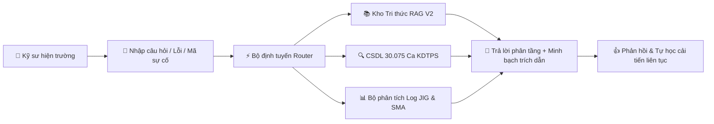

# CẨM NANG HƯỚNG DẪN SỬ DỤNG TOÀN DIỆN SỔ CÁI AIOS
## HỆ THỐNG TRỢ LÝ ĐIỀU TRA SỰ CỐ & GIÁM SÁT SẢN XUẤT THÔNG MINH

> **Dành cho:** Kỹ sư hiện trường, Trưởng ca sản xuất, Kỹ thuật viên bảo trì và Ban Quản lý Chất lượng (Người dùng chính: Anh Vinh).  
> **Phiên bản:** Sổ Cái AIOS Desktop v2.5 (Hỗ trợ máy tính để bàn & thiết bị di động).  
> **Thời điểm cập nhật:** 2026-10-23.  
> **Phương châm thiết kế:** *"Nhanh — Chuẩn xác — Minh bạch nguồn gốc — An toàn dữ liệu"*.

---

## MỤC LỤC TỔNG QUAN

- [1. GIỚI THIỆU CHUNG & QUY TRÌNH TÁC NGHIỆP](#1-giới-thiệu-chung--quy-trình-tác-nghiệp)
- [2. PHẦN 1: NHÓM A — ĐƯỜNG GỬI & KHUNG CHAT](#phần-1-nhóm-a--đường-gửi--khung-chat)
  - [A1. Gửi câu hỏi & Cơ chế chống gửi lặp (Idempotency)](#a1-gửi-câu-hỏi--cơ-chế-chống-gửi-lặp-idempotency)
  - [A2. Bấm chip gợi ý nhanh khi worker đang nạp](#a2-bấm-chip-gợi-ý-nhanh-khi-worker-đang-nạp)
  - [A3. Mở sổ lạnh rồi chờ: Tự mở khóa và bảo lưu câu hỏi](#a3-mở-sổ-lạnh-rồi-chờ-tự-mở-khóa-và-bảo-lưu-câu-hỏi)
  - [A4. Bẫy nhập theo nhịp người (Human Cadence)](#a4-bẫy-nhập-theo-nhịp-người-human-cadence)
  - [A5. Thẻ chờ 3 bước trung thực](#a5-thẻ-chờ-3-bước-trung-thực)
- [3. PHẦN 2: NHÓM B — HỎI ĐÁP THEO KHO & TRA CỨU SỐ LIỆU CHUẨN](#phần-2-nhóm-b--hỏi-đáp-theo-kho--tra-cứu-số-liệu-chuẩn)
  - [B1. Tác nghiệp trên 4 kho tri thức chuyên biệt](#b1-tác-nghiệp-trên-4-kho-tri-thức-chuyên-biệt)
  - [B2. Tra cứu số liệu có cấu trúc (Đối chiếu Ground Truth)](#b2-tra-cứu-số-liệu-có-cấu-trúc-đối-chiếu-ground-truth)
  - [B3. Tra cứu lỗi tương tự với nhãn chuẩn "Vụ"](#b3-tra-cứu-lỗi-tương-tự-với-nhãn-chuẩn-vụ)
  - [B4. Tra cứu mở theo cửa sổ thời gian & Dòng máy](#b4-tra-cứu-mở-theo-cửa-sổ-thời-gian--dòng-máy)
  - [B5. Chuẩn hóa ngôn ngữ thuần Việt trong câu trả lời kỹ thuật](#b5-chuẩn-hóa-ngôn-ngữ-thuần-việt-trong-câu-trả-lời-kỹ-thuật)
- [4. PHẦN 3: NHÓM C — NGHIỆP VỤ ĐIỀU TRA SỰ CỐ BƯỚC 1 ĐẾN BƯỚC 5](#phần-3-nhóm-c--nghiệp-vụ-điều-tra-sự-cố-bước-1-đến-bước-5)
  - [C1. Hướng dẫn phân tầng điều tra sự cố (Bước 3) cho người mới](#c1-hướng-dẫn-phân-tầng-điều-tra-sự-cố-bước-3-cho-người-mới)
  - [C2. Phân tích log JIG/LSU & Thẻ cảnh báo xu hướng SMA(20)](#c2-phân-tích-log-jiglsu--thẻ-cảnh-báo-xu-hướng-sma20)
  - [C3. Báo cáo xu hướng định kỳ trực tiếp trong ô chat](#c3-báo-cáo-xu-hướng-định-kỳ-trực-tiếp-trong-ô-chat)
  - [C4. Phân loại tự động & Thẻ Cảnh báo Tái phát Bước 5 (C7620)](#c4-phân-loại-tự-động--thẻ-cảnh-báo-tái-phát-bước-5-c7620)
- [5. PHẦN 4: NHÓM D — PHẢN HỒI ĐÁNH GIÁ & TỰ HỌC THÓI QUEN](#phần-4-nhóm-d--phản-hồi-đánh-giá--tự-học-thói-quen)
  - [D1. Đánh giá Thích / Không thích kèm bảng chọn 4 lý do](#d1-đánh-giá-thích--không-thích-kèm-bảng-chọn-4-lý-do)
  - [D2. Hàng đợi chuyên gia 3 phần và điểm xác thực PIN bảo mật](#d2-hàng-đợi-chuyên-gia-3-phần-và-điểm-xác-thực-pin-bảo-mật)
  - [D3. Tầng nguồn bản thảo (nhãn Bản thảo — chưa kiểm chứng)](#d3-tầng-nguồn-bản-thảo-nhãn-bản-thảo--chưa-kiểm-chứng)
  - [D4. Bảng Quản trị Tự học Thói quen (Master Switch & Xóa hồ sơ)](#d4-bảng-quản-trị-tự-học-thói-quen-master-switch--xóa-hồ-sơ)
- [6. PHẦN 5: NHÓM E — CHẾ ĐỘ TÌM KIẾM & HIỂN THỊ THÔNG MINH](#phần-5-nhóm-e--chế-độ-tìm-kiếm--hiển-thị-thông-minh)
  - [E1. Nấc thang trả lời 5 bậc khi gặp câu hỏi ngoài dữ liệu](#e1-nấc-thang-trả-lời-5-bậc-khi-gặp-câu-hỏi-ngoài-dữ-liệu)
  - [E2. Chế độ Hỏi AI ngoài an toàn (Bảo vệ dữ liệu mật)](#e2-chế-độ-hỏi-ai-ngoài-an-toàn-bảo-vệ-dữ-liệu-mật)
  - [E3. Trình xem trích dẫn tài liệu gốc (Source Viewer)](#e3-trình-xem-trích-dẫn-tài-liệu-gốc-source-viewer)
  - [E4. Hiển thị câu trả lời chạy chữ dần (Streaming)](#e4-hiển-thị-câu-trả-lời-chạy-chữ-dần-streaming)
  - [E5. Chuyển đổi 3 chế độ tìm kiếm trên thanh công cụ](#e5-chuyển-đổi-3-chế-độ-tìm-kiếm-trên-thanh-công-cụ)
  - [E6. Tuyến xử lý Command Code & Giám sát kết nối C-Agent](#e6-tuyến-xử-lý-command-code--giám-sát-kết-nối-c-agent)
- [7. PHẦN 6: NHÓM F — QUẢN LÝ SỔ TAY & HỘI THOẠI](#phần-6-nhóm-f--quản-lý-sổ-tay--hội-thoại)
  - [F1. Tạo sổ mới, tạo hội thoại mới và chuyển đổi đa sổ tay](#f1-tạo-sổ-mới-tạo-hội-thoại-mới-và-chuyển-đổi-đa-sổ-tay)
  - [F2. Mở lại hội thoại cũ và tiếp nối mạch tư duy](#f2-mở-lại-hội-thoại-cũ-và-tiếp-nối-mạch-tư-duy)
- [8. PHẦN 7: NHÓM G — CÁC TÍNH NĂNG NÂNG CAO BỔ SUNG (G1 ĐẾN G18)](#phần-7-nhóm-g--các-tính-năng-nâng-cao-bổ-sung-g1-đến-g18)
  - [G1. Đính kèm tệp đa định dạng & OCR tệp lớn đến 64MB](#g1-đính-kèm-tệp-đa-định-dạng--ocr-tệp-lớn-đến-64mb)
  - [G2. Tạo ca điều tra lỗi mới từ giao diện chat](#g2-tạo-ca-điều-tra-lỗi-mới-từ-giao-diện-chat)
  - [G3. Nạp tài liệu mới vào từng kho & Nhãn thăm dò sẵn sàng](#g3-nạp-tài-liệu-mới-vào-từng-kho--nhãn-thăm-dò-sẵn-sàng)
  - [G4. OCR Indra khi nạp tài liệu quét và bản vẽ kỹ thuật](#g4-ocr-indra-khi-nạp-tài-liệu-quét-và-bản-vẽ-kỹ-thuật)
  - [G5. Phỏng vấn chuyên gia LSU và tích hợp tri thức vào kho](#g5-phỏng-vấn-chuyên-gia-lsu-và-tích-hợp-tri-thức-vào-kho)
  - [G6. Bộ dựng biểu đồ log trên máy tính (Log Chart Builder)](#g6-bộ-dựng-biểu-đồ-log-trên-máy-tính-log-chart-builder)
  - [G7. Cảnh báo LSU thời gian thực & Thẻ RT mở vết (Trace Link)](#g7-cảnh-báo-lsu-thời-gian-thực--thẻ-rt-mở-vết-trace-link)
  - [G8. Lọc sự cố theo dòng máy, số serial và khoảng ngày](#g8-lọc-sự-cố-theo-dòng-máy-số-serial-và-khoảng-ngày)
  - [G9. Hỏi đích danh tên tài liệu kỹ thuật](#g9-hỏi-đích-danh-tên-tài-liệu-kỹ-thuật)
  - [G10. Bộ chọn khối kiến thức và tính năng ghim làn ưu tiên](#g10-bộ-chọn-khối-kiến-thức-và-tính-năng-ghim-làn-ưu-tiên)
  - [G11. Trả lời tiếp ngay trong câu trả lời & Chống hiển thị trùng](#g11-trả-lời-tiếp-ngay-trong-câu-trả-lời--chống-hiển-thị-trùng)
  - [G12. Hiển thị tên nguồn, ngày tháng chuẩn và Source Viewer](#g12-hiển-thị-tên-nguồn-ngày-tháng-chuẩn-và-source-viewer)
  - [G13. Cơ chế lưu bền hộp nháp khi tải lại hoặc chuyển trang](#g13-cơ-chế-lưu-bền-hộp-nháp-khi-tải-lại-hoặc-chuyển-trang)
  - [G14. Xem nhật ký sử dụng AI ngoài kèm đo lường thời gian](#g14-xem-nhật-ký-sử-dụng-ai-ngoài-kèm-đo-lường-thời-gian)
  - [G15. Lớp tập trung review chuyên gia & Lệnh chat xem phản hồi](#g15-lớp-tập-trung-review-chuyên-gia--lệnh-chat-xem-phản-hồi)
  - [G16. Tự học sau phiên hội thoại & Kho kỹ năng Curator](#g16-tự-học-sau-phiên-hội-thoại--kho-kỹ-năng-curator)
  - [G17. Tự động định tuyến câu hỏi chứa mã lỗi vào CSDL ca sự cố](#g17-tự-động-định-tuyến-câu-hỏi-chứa-mã-lỗi-vào-csdl-ca-sự-cố)
  - [G18. Vận hành CSDL gộp 30.075 ca và cơ chế chuyển mạch cấu hình](#g18-vận-hành-csdl-gộp-30075-ca-và-cơ-chế-chuyển-mạch-cấu-hình)
- [8. PHỤ LỤC: BẢNG TRA CỨU NHANH CÁC THAO TÁC CỐT LÕI](#8-phụ-lục-bảng-tra-cứu-nhanh-các-thao-tác-cốt-lõi)
- [9. DANH MỤC LỆNH HỆ THỐNG (SLASH COMMANDS)](#9-danh-mục-lệnh-hệ-thống-slash-commands)

---

## 1. GIỚI THIỆU CHUNG & QUY TRÌNH TÁC NGHIỆP

Hệ thống **Sổ Cái AIOS** là nền tảng trợ lý trí tuệ nhân tạo được xây dựng chuyên biệt cho môi trường chế tạo và sản xuất thiết bị in ấn công nghiệp. Hệ thống tích hợp toàn bộ dữ liệu lịch sử sự cố (30.075 ca KDTPS), hồ sơ kỹ thuật dòng máy (Iris, Virgo, 6th Next, Libra...), nhật ký vận hành MES/Opcenter và các bài đo hiệu chuẩn công đoạn quang học LSU.

---

## PHẦN 1: NHÓM A — ĐƯỜNG GỬI & KHUNG CHAT

### A1. Gửi câu hỏi & Cơ chế chống gửi lặp (Idempotency)
- **Mục đích:** Đảm bảo khi gửi câu hỏi và buông tay trong thời gian dài ($\ge 60$ giây), hệ thống chỉ ghi nhận duy nhất 1 lượt hỏi-đáp, không bị gửi trùng lặp hay treo giao diện.
- **Thao tác:** Gõ câu hỏi *"Bảo dưỡng máy in photocopy định kỳ gồm những bước nào?"*, bấm Gửi và để yên tay không thao tác trong 65 giây.
- **Minh chứng thực tế:** Giao diện tiếp nhận đúng 1 lượt, sinh câu trả lời hoàn tất.

---

### A2. Bấm chip gợi ý nhanh khi worker đang nạp
- **Mục đích:** Giúp kỹ sư bấm ngay câu hỏi gợi ý khi mở sổ lạnh mà không bị nuốt mất lệnh; worker sau khi nạp xong sẽ trả lời ngay.
- **Thao tác:** Mở sổ lạnh `NB-LAZY-MOM`, bấm ngay chip gợi ý đầu tiên trong lúc hệ thống đang warm-up.
- **Minh chứng thực tế:** Câu hỏi được giữ nguyên và trả lời đầy đủ ngay khi worker sẵn sàng.

---

### A3. Mở sổ lạnh rồi chờ: Tự mở khóa và bảo lưu câu hỏi
- **Mục đích:** Bảo vệ 100% nội dung đã gõ. Nút Gửi tự động mở khóa ngay khi worker nạp xong mà không làm mất chữ.
- **Thao tác:** Mở sổ `NB-LAZY-LSU`, gõ sẵn câu hỏi vào textarea trước khi worker nạp xong.
- **Minh chứng thực tế:** Nút Gửi tự động sáng lên, câu hỏi được bảo toàn nguyên vẹn.

---

### A4. Bẫy nhập theo nhịp người (Human Cadence)
- **Mục đích:** Kỹ sư vừa gõ vừa dừng suy nghĩ không bị hệ thống gửi vội vã hoặc rơi vào vòng chờ giả (*false loop*).
- **Thao tác:** Gõ câu hỏi với độ trễ tự nhiên 22ms/ký tự, dừng tay 2.5 giây giữa chừng rồi bấm Gửi.
- **Minh chứng thực tế:** Tiếp nhận trọn vẹn câu hỏi hoàn chỉnh.

---

### A5. Thẻ chờ 3 bước trung thực
- **Mục đích:** Minh bạch hoàn toàn quá trình xử lý qua 3 bước riêng biệt: `1. Tìm nguồn` $
ightarrow$ `2. Phân tích dữ kiện` $
ightarrow$ `3. Soạn câu trả lời`.
- **Thao tác:** Quan sát thanh tiến trình khi AI bắt đầu xử lý yêu cầu.
- **Minh chứng thực tế:** Mỗi bước hiển thị thời gian thực tế riêng, không nhảy cóc xuống bước 3.

---

## PHẦN 2: NHÓM B — HỎI ĐÁP THEO KHO & TRA CỨU SỐ LIỆU CHUẨN

### B1. Tác nghiệp trên 4 kho tri thức chuyên biệt
Hệ thống phân chia thành 4 kho độc lập để tránh nhầm lẫn dữ liệu:
1. **Kho LSU (`NB-LAZY-LSU`):** Quy cách dán SIM tape MIRROR C dày 40μm, căn chỉnh Jig.
2. **Kho Điều tra lỗi (`NB-LAZY-DTL`):** 30.075 ca sự cố KDTPS, mã lỗi SC, kẹt giấy JAM.
3. **Kho MOM/Opcenter (`NB-LAZY-MOM`):** Quy trình dừng máy khẩn cấp, phối hợp điều hành MES.
4. **Kho Tri thức tổng hợp (`NB-C26E1C84`):** Cẩm nang bảo dưỡng định kỳ, quy chuẩn 5S.

---

### B2. Tra cứu số liệu có cấu trúc (Đối chiếu Ground Truth)
Đối chiếu các mốc số liệu đã được phê duyệt trong toàn bộ CSDL nhà máy:
- **C7620 tái phát:** Chuẩn **136 vụ** (ca mới nhất ngày 15/10/2026 vụ `FY27H2/263`).
- **C6770:** Chuẩn **33 vụ**.
- **C7620 trong năm 2025:** Chuẩn **60 vụ**.
- **JAM4212:** 
  - **Đường đếm cấu trúc (`Tra cứu mã lỗi JAM4212`):** Hiển thị rõ ràng **24 ca** khớp trực tiếp cột mã lỗi chuẩn (`error_code_i`, `error_code_h`, `error_code_c`).
  - **Đường tra cứu tương tự / Mở rộng:** Tổng số liên quan thực tế sau lọc nhiễu là **63 vụ** theo ground-truth chốt.

---

### B3. Tra cứu lỗi tương tự với nhãn chuẩn "Vụ"
- **Mục đích:** Thống nhất đơn vị đo lường sự cố là **"Vụ"** (thay thế thuật ngữ cũ "Phiếu"), gắn liền giải thích nguồn số đăng ký `History KDTPS.xlsx`.
- **Thao tác:** Gõ tìm các ca lỗi liên quan kẹt giấy, đối chiếu nhãn hiển thị.

---

### B4. Tra cứu mở theo cửa sổ thời gian & Dòng máy
Khoanh vùng phân tích sự cố theo từng đợt sản xuất:
1. **Virgo Tháng 8–10/2023 x Postcard lệch:** Chuẩn **11 vụ**.
2. **Virgo Quý 4/2023 x Postcard lệch:** Chuẩn **12 vụ**.
3. **6th Next Tháng 1/2023 x Trắng màn hình:** Chuẩn **1 vụ** (vụ `2023/38`).
4. **Iris cùng hiện tượng:** Thông báo **0 vụ**, đồng thời gợi ý kỹ sư tham khảo kết quả trên dòng máy tương đương Virgo.

---

### B5. Chuẩn hóa ngôn ngữ thuần Việt trong câu trả lời kỹ thuật
- **Mục đích:** Thân câu trả lời 100% bằng tiếng Việt chuẩn kỹ thuật có dấu trên cả 4 đường trả lời chính (Tổng hợp, Tra cứu tương tự, Cấu trúc, Bản nháp), không còn tiếng Nhật thô chưa dịch (từ `不要` được dịch sạch thành "Không cần đối sách bổ sung / Đã xử lý tại chỗ không cần đối sách chính thức").
- **Kiểm tra định nghĩa từ điển mã lỗi JAM4212:** Trong câu trả lời tổng hợp/tương tự, mục 1 (Định nghĩa kỹ thuật) đã dịch sạch sẽ 100% sang tiếng Việt: *"Kẹt giấy tại cảm biến sấy (Cấp giấy khay 2)"*, cơ chế *"Đã qua thời gian quy định từ khi cảm biến phát hiện cuốn giấy trung gian ngắt (OFF) nhưng cảm biến sấy vẫn chưa ngắt (OFF)"*.
- **4 đường trả lời chuẩn hóa thuần Việt:**
  1. *Đường Tổng hợp:* Quy trình bảo dưỡng máy photocopy định kỳ 5 bước rõ ràng thuần Việt.
  2. *Đường Tra cứu tương tự:* Định nghĩa từ điển mã lỗi dịch sạch 100% sang tiếng Việt trong thân câu trả lời.
  3. *Đường Cấu trúc:* C7620 năm 2025 hiển thị 60 ca, dịch sạch thuật ngữ xử lý.
  4. *Đường Bản nháp:* Câu trả lời kho MOM/Opcenter thuần Việt có thẻ cảnh báo suy luận kỹ thuật.

---

## PHẦN 3: NHÓM C — NGHIỆP VỤ ĐIỀU TRA SỰ CỐ BƯỚC 1 ĐẾN BƯỚC 5

### C1. Hướng dẫn phân tầng điều tra sự cố (Bước 3) cho người mới
- **Mục đích:** Cung cấp quy trình điều tra từng bước có cấu trúc (An toàn $
ightarrow$ Hiện trường $
ightarrow$ Cơ khí $
ightarrow$ Cảm biến $
ightarrow$ Bo mạch) giúp người mới có thể tự xử lý ban đầu.
- **Thao tác:** Gõ *"gợi ý hướng điều tra máy in bị kẹt giấy trước cụm sấy, cơ cấu áp sấy không quay..."*.

---

### C2. Phân tích log JIG/LSU & Thẻ cảnh báo xu hướng SMA(20)
- **Mục đích:** Nạp tệp log sản xuất lớn (30.87MB), hệ thống tự động phát hiện xu hướng bất thường theo quy tắc SMA(20) khi có $\ge 3$ điểm xấu liên tiếp vượt $2.5\sigma$.
- **Thao tác:** Tải log `2025_02.csv`, quan sát cảnh báo thông số `MeasureFieldCurvatureYellow`.

---

### C3. Báo cáo xu hướng định kỳ trực tiếp trong ô chat
- **Mục đích:** Xuất bản báo cáo tổng hợp chất lượng, tỷ lệ lỗi phân bổ theo dây chuyền ngay trong dòng trò chuyện.
- **Thao tác:** Gõ *"Báo cáo xu hướng định kỳ"*.

---

### C4. Phân loại tự động & Thẻ Cảnh báo Tái phát Bước 5 (C7620)
- **Mục đích:** Đối với các lỗi có nguy cơ lặp lại cao, hệ thống tự động đính kèm **Thẻ Cảnh báo Tái phát Bước 5** màu cam nổi bật, cung cấp số liệu thống kê lịch sử và đối sách đã được kiểm chứng.
- **Thao tác:** Gõ lệnh tạo ca: *"Tạo vụ điều tra lỗi mới: kẹt giấy cụm sấy lỗi C7620"*.
- **Kết quả:** Thẻ cảnh báo tái phát xuất hiện rõ ràng: *Tái phát: mã C7620 đã xuất hiện 136 lần trong cơ sở dữ liệu lịch sử (30.075 ca). Ca gần nhất: vụ FY27H2/263*.

---

## PHẦN 4: NHÓM D — PHẢN HỒI ĐÁNH GIÁ & TỰ HỌC THÓI QUEN

### D1. Đánh giá Thích / Không thích kèm bảng chọn 4 lý do
- **Mục đích:** Ghi nhận đánh giá của kỹ sư để cải thiện chất lượng AI. Khi bấm Chê (Thumbs Down), popup hiện 4 lý do chuẩn (*Sai*, *Khó hiểu*, *Thiếu nguồn*, *Lạc đề*) kèm ô nhập giải thích.

---

### D2. Hàng đợi chuyên gia 3 phần và điểm xác thực PIN bảo mật
- **Mục đích:** Quản lý các đề xuất tri thức mới chờ chuyên gia duyệt vào kho chính thức. Quy trình dừng đúng tại điểm xác thực mã PIN bảo mật máy chủ.

---

### D3. Tầng nguồn bản thảo (nhãn Bản thảo — chưa kiểm chứng)
- **Mục đích:** Câu trả lời có sử dụng dữ liệu bản thảo chưa duyệt sẽ được gắn nhãn cảnh báo rõ ràng, đồng thời cô lập kho tuyệt đối không để rò rỉ chéo sang sổ khác.

---

### D4. Bảng Quản trị Tự học Thói quen (Master Switch & Xóa hồ sơ)
- **Mục đích:** Cho phép người dùng bật/tắt công tắc tự học tổng (Master Switch) và quản lý an toàn hồ sơ thói quen cá nhân trên sidebar.

---

## PHẦN 5: NHÓM E — CHẾ ĐỘ TÌM KIẾM & HIỂN THỊ THÔNG MINH

### E1. Nấc thang trả lời 5 bậc khi gặp câu hỏi ngoài dữ liệu
- **Mục đích:** Khi gặp câu hỏi nằm ngoài phạm vi tài liệu nhà máy, AIOS không từ chối thô bạo mà kích hoạt nấc thang Tier 4 với nhận định suy luận kèm 3 nút hành động Tier 5 (*Dạy AIOS*, *Hỏi chuyên gia*, *Hỏi AI ngoài*).

---

### E2. Chế độ Hỏi AI ngoài an toàn (Bảo vệ dữ liệu mật)
- **Mục đích:** Khi cần tra cứu kiến thức công nghệ chung từ internet, chế độ này chỉ gửi câu hỏi và lịch sử trao đổi, tuyệt đối không gửi tài liệu mật nội bộ ra ngoài.

---

### E3. Trình xem trích dẫn tài liệu gốc (Source Viewer)
- **Mục đích:** Nhấp chuột vào các thẻ trích dẫn tài liệu trong câu trả lời để mở panel xem nguyên văn định nghĩa, nguyên nhân, đối sách và tải tài liệu gốc.

---

### E4. Hiển thị câu trả lời chạy chữ dần (Streaming)
- **Mục đích:** Chữ được đổ ra mượt mà theo nhịp sinh câu trả lời kèm thẻ trạng thái, giúp người dùng theo dõi nội dung liên tục không phải chờ đợi lâu.

---

### E5. Chuyển đổi 3 chế độ tìm kiếm trên thanh công cụ
- **Mục đích:** Nút `⚡` trên thanh công cụ cho phép chuyển đổi nhanh giữa 3 chế độ tìm kiếm: **Tự động**, **Tìm nhanh**, và **Theo dữ kiện**.

---

### E6. Tuyến xử lý Command Code & Giám sát kết nối C-Agent
- **Mục đích:** Tuyến mặc định hoạt động là Command Code (Router) với chuỗi dự phòng failover; chấm trạng thái C-Agent hiển thị màu đỏ chính xác theo mạng nội bộ máy nhà.

---

## PHẦN 6: NHÓM F — QUẢN LÝ SỔ TAY & HỘI THOẠI

### F1. Tạo sổ mới, tạo hội thoại mới và chuyển đổi đa sổ tay
- **Mục đích:** Thao tác mượt mà giữa Sổ nóng (LSU, Điều tra lỗi) và Sổ lạnh (MOM, Tổng hợp). Nút `➕ Tạo cuộc trò chuyện mới` làm sạch phiên làm việc tức thì.

---

### F2. Mở lại hội thoại cũ và tiếp nối mạch tư duy
- **Mục đích:** Lưu trữ lịch sử trao đổi trên sidebar. Kỹ sư có thể mở lại bất kỳ hội thoại nào trong quá khứ để đọc lại và hỏi tiếp nối mạch tư duy.

---

## PHẦN 7: NHÓM G — CÁC TÍNH NĂNG NÂNG CAO BỔ SUNG (G1 ĐẾN G18)

### G1. Đính kèm tệp đa định dạng & OCR tệp lớn đến 64MB
- **Mục đích:** Cho phép kỹ sư tải lên các tệp dữ liệu lớn (CSV, bảng tính, log sản xuất đến 64MB) hoặc hình ảnh chụp hiện trường để OCR trích xuất văn bản trực tiếp vào câu hỏi.
- **Thao tác:** Bấm biểu tượng kẹp giấy ở khung soạn thảo hoặc dán trực tiếp từ Clipboard (`Ctrl + V`).

---

### G2. Tạo ca điều tra lỗi mới từ giao diện chat
- **Mục đích:** Khởi tạo ca điều tra sự cố mới trực tiếp từ ô chat (không cần mở form nhập liệu phức tạp). AIOS tự động bóc tách hiện tượng, dây chuyền, model máy, mã lỗi và sinh cây điều tra ban đầu.
- **Thao tác:** Gõ: *"Tạo vụ điều tra lỗi mới: kẹt giấy khay 2 line 3 máy Iris2024"*.

---

### G3. Nạp tài liệu mới vào từng kho & Nhãn thăm dò sẵn sàng
- **Mục đích:** Cơ chế nạp tài liệu mới vào 4 kho tri thức (LSU, DTL, MOM, Tổng hợp) với nhãn thăm dò (probe label) kiểm tra tính toàn vẹn và khả năng truy hồi tức thì sau khi nạp.

---

### G4. OCR Indra khi nạp tài liệu quét và bản vẽ kỹ thuật
- **Mục đích:** Ứng dụng mô hình Indra OCR nhận diện các tài liệu kỹ thuật scan thuần (như báo cáo lỗi C6610 31 trang, sơ đồ mạch 7PA1187DCZ), trích xuất chính xác chữ Kana/Kanji tiếng Nhật và mã linh kiện PWB.

---

### G5. Phỏng vấn chuyên gia LSU và tích hợp tri thức vào kho
- **Mục đích:** Thu thập tri thức thực tế từ các chuyên gia vận hành công đoạn quang học LSU (33 dòng review pack), đưa vào kho chính thức để trợ lý trả lời chính xác các câu hỏi căn chỉnh chuyên sâu.

---

### G6. Bộ dựng biểu đồ log trên máy tính (Log Chart Builder)
- **Mục đích:** Trực quan hóa dữ liệu tệp log sản xuất lớn (30.87MB) thành các biểu đồ Takt Time, Bow Skew, và đối chiếu chuẩn xác 3 điểm giá trị với tệp log thô.

---

### G7. Cảnh báo LSU thời gian thực & Thẻ RT mở vết (Trace Link)
- **Mục đích:** Giám sát liên tục các thông số JIG LSU, kích hoạt thẻ cảnh báo xu hướng SMA(20) khi có $\ge 3$ điểm xấu liên tiếp và cung cấp đường link mở vết (trace) truy ngược về tệp log gốc.

---

### G8. Lọc sự cố theo dòng máy, số serial và khoảng ngày
- **Mục đích:** Cho phép tra cứu kết hợp nhiều điều kiện: dòng máy (Iris, Virgo, 6th Next, Libra...), số serial linh kiện và cửa sổ thời gian phát sinh cụ thể trong CSDL 30.075 ca.
- **Thao tác:** Gõ: *"Tìm kiếm ca lỗi máy Iris2024 số serial 1G55809417 ngày 2025-08-22"*.

---

### G9. Hỏi đích danh tên tài liệu kỹ thuật
- **Mục đích:** Khi người dùng nêu đích danh tên tệp tài liệu trong câu hỏi (ví dụ `KTD-2026-06-0647-Iris2024-C33-A-JAM4212.xlsx`), AIOS tự động định tuyến và ưu tiên trích xuất nội dung từ chính tài liệu đó.

---

### G10. Bộ chọn khối kiến thức và tính năng ghim làn ưu tiên
- **Mục đích:** Tùy biến phạm vi tra cứu trên sidebar hoặc thanh công cụ; tính năng Ghim làn (Pin Lane) giúp cố định một kho tri thức cho toàn bộ phiên làm việc tiếp theo.

---

### G11. Trả lời tiếp ngay trong câu trả lời & Chống hiển thị trùng
- **Mục đích:** Bấm nút "Hỏi tiếp về nội dung này" ngay dưới câu trả lời của trợ lý để đặt câu hỏi đào sâu ngữ cảnh, đảm bảo không bị nhân đôi dòng miễn trừ trách nhiệm hoặc lặp biểu đồ.

---

### G12. Hiển thị tên nguồn, ngày tháng chuẩn và Source Viewer
- **Mục đích:** Mọi gợi ý xử lý đều trích dẫn rõ tên tài liệu gốc, vị trí hàng/cột và ngày phát sinh không bị che sai; nhấp chuột để mở cửa sổ xem trực tiếp văn bản nguồn.

---

### G13. Cơ chế lưu bền hộp nháp khi tải lại hoặc chuyển trang
- **Mục đích:** Người dùng đang gõ dở câu hỏi hoặc ghi chú nếu vô tình chuyển sang sổ khác hoặc làm mới trang trình duyệt (`F5`), nội dung nháp vẫn được lưu bền vững trên đĩa và hiển thị lại nguyên vẹn.

---

### G14. Xem nhật ký sử dụng AI ngoài kèm đo lường thời gian
- **Mục đích:** Toàn bộ các phiên trao đổi ở chế độ Hỏi AI ngoài được ghi vết minh bạch vào tệp nhật ký `external_ai_usage.jsonl`, ghi nhận chính xác thời gian phản hồi (`duration_sec`) và thời gian bắt đầu nhận chữ (`ttft_sec`).

---

### G15. Lớp tập trung review chuyên gia & Lệnh chat xem phản hồi
- **Mục đích:** Cung cấp không gian làm việc tập trung cho Chuyên gia rà soát các phản hồi chưa đạt; hỗ trợ lệnh chat nhanh `xem phản hồi` để mở bảng tổng hợp ngay trong ô chat.

---

### G16. Tự học sau phiên hội thoại & Kho kỹ năng Curator
- **Mục đích:** Sau mỗi phiên hội thoại dài, hệ thống tự động tổng hợp bài học kinh nghiệm vào biểu mẫu "Sửa để AIOS học", lưu trữ trong kho tri thức Second Brain Vault để phục vụ các phiên làm việc tiếp theo.

---

### G17. Tự động định tuyến câu hỏi chứa mã lỗi vào CSDL ca sự cố
- **Mục đích:** Bất kỳ câu hỏi tự nhiên nào chứa mã lỗi kỹ thuật (C7620, C6770, JAM4212, F000...) đều được nhận diện tự động và chuyển thẳng vào cơ chế phân tích đối chiếu 30.075 ca KDTPS.

---

### G18. Vận hành CSDL gộp 30.075 ca và cơ chế chuyển mạch cấu hình
- **Mục đích:** Toàn bộ hệ thống máy nhà vận hành trên CSDL gộp chuẩn **30.075 ca lịch sử** (`error_cases_reconciled.db`). Cơ chế chuyển mạch cấu hình cho phép kiểm tra đối chứng và quay lui an toàn chỉ bằng biến môi trường `AIOS_ERROR_CASES_DB` mà không phải sửa đổi mã nguồn.

---

## 8. PHỤ LỤC: BẢNG TRA CỨU NHANH CÁC THAO TÁC CỐT LÕI

| Tác vụ cần thực hiện | Vị trí thao tác | Lệnh hoặc Thao tác mẫu | Kết quả mong đợi |
| :--- | :--- | :--- | :--- |
| **Tra cứu mã lỗi nhanh** | Sổ Điều tra lỗi | `Tra cứu mã lỗi C7620` | Hiện 136 vụ, nguyên nhân cáp dẹt và đối sách chuẩn |
| **Đếm số lượng ca lỗi** | Sổ Điều tra lỗi | `C7620 năm 2025` | Trả về chính xác đúng 60 ca |
| **Tạo ca điều tra mới** | Sổ Điều tra lỗi | `Tạo vụ điều tra lỗi mới: kẹt giấy khay 2 line 3` | Hiện Thẻ Xem Trước, gợi ý Bước 5 và 3-5 ca tương tự |
| **Kích hoạt cảnh báo tái phát** | Sổ Điều tra lỗi | `Tạo vụ điều tra lỗi mới: kẹt giấy cụm sấy lỗi C7620` | Hiện Thẻ Cảnh báo Tái phát Bước 5 (136 ca, vụ FY27H2/263) |
| **Phân tích log sản xuất** | Sổ LSU | Đính kèm tệp `2025_02.csv` | Vẽ biểu đồ Takt Time, cảnh báo SMA(20) khi có $\ge 3$ điểm xấu |
| **Xem báo cáo tuần/tháng** | Bất kỳ sổ nào | `Báo cáo xu hướng định kỳ` | Bảng thống kê tỷ lệ lỗi theo dây chuyền |
| **Chuyển chế độ tìm kiếm** | Thanh công cụ | Bấm nút `⚡` | Chọn giữa Tự động, Tìm nhanh và Theo dữ kiện |
| **Hỏi tri thức bên ngoài** | Thanh công cụ | Bấm nút `🌐 Hỏi AI ngoài` | Hỏi kiến thức mở an toàn, không rò rỉ tài liệu nội bộ |
| **Đánh giá câu trả lời** | Dưới tin nhắn AI | Bấm nút `👎` | Chọn 1 trong 4 lý do và nhập góp ý cải thiện |
| **Xem phản hồi chờ duyệt** | Khung chat | `xem phản hồi` | Bảng tổng hợp các phản hồi đang chờ Chuyên gia phê duyệt |

## 9. DANH MỤC LỆNH HỆ THỐNG (SLASH COMMANDS)

Khi gõ `/` ở đầu ô soạn câu hỏi, hệ thống sẽ tự động hiển thị bảng gợi ý lệnh kèm mô tả và câu tự nhiên tương đương.
Người dùng cũng có thể gõ câu nói tự nhiên thông thường, AIOS sẽ tự động nhận diện ý định và kích hoạt tính năng tương ứng.

| Lệnh chính & Biến thể | Câu tự nhiên tương đương | Công dụng chức năng | Ngữ cảnh cần thiết | Nhóm tính năng |
| :--- | :--- | :--- | :--- | :--- |
| **`/huongdan`** Biến thể: `/huong-dan`, `/使い方`, `/つかいかた`, `/使用指南` | `hướng dẫn sử dụng aios` | Mở cẩm nang hướng dẫn sử dụng AIOS (hỗ trợ 3 ngôn ngữ Việt/Nhật/Trung) | Bất kỳ sổ nào | **Hướng dẫn sử dụng** |
| **`/baocaodinhky`** Biến thể: `/baocaoxuhuong` | `báo cáo xu hướng định kỳ` | Xuất báo cáo xu hướng định kỳ tình hình lỗi theo dây chuyền và tuần sản xuất | Bất kỳ sổ nào | **Báo cáo & Xu hướng** |
| **`/phanloai`** Biến thể: `/phanloai-phanhoi`, `/phanloai-duyet` | `xem phản hồi phân loại` | Xem tổng hợp thống kê và đánh giá nhãn phân loại tự động sự cố Bước 5 | Bất kỳ sổ nào (đọc từ local_cases) | **Phân loại Bước 5** |
| **`/dieutra-phanhoi`** Biến thể: `/dieutra-duyet`, `/dieutra` | `xem phản hồi điều tra` | Xem tổng hợp đánh giá và góp ý cây điều tra sự cố 4M Bước 3 | Bất kỳ sổ nào (đọc từ local_cases) | **Điều tra sự cố** |
| **`/danhgiadieutra`** Biến thể: *(không)* | `cây điều tra đúng hướng` | Đánh giá nhanh gợi ý cây điều tra 4M (đúng hướng, thiếu nhánh, không hữu ích) | Sổ Điều tra lỗi (ngữ cảnh ca điều tra đang mở) | **Điều tra sự cố** |
| **`/danhgianhan`** Biến thể: *(không)* | `đánh giá đúng nhãn` | Đánh giá độ chính xác của nhãn phân loại tự động Bước 5 (đúng nhãn, sai, một phần) | Sổ Điều tra lỗi (ngữ cảnh phân loại sự cố) | **Phân loại Bước 5** |
| **`/dongvu`** Biến thể: `/dong-vu` | `đóng vụ điều tra` | Đóng vụ điều tra sự cố kèm bắt buộc ghi nhận nguyên nhân thật và biện pháp khắc phục | Sổ Điều tra lỗi (yêu cầu mã vụ, nguyên nhân và đối sách) | **Đóng vụ điều tra** |
| **`/phanhoi`** Biến thể: `/xemphanhoi` | `xem phản hồi` | Xem tổng hợp thống kê tỷ lệ hài lòng (đạt/chê) và lý do phản hồi đáp án AI | Bất kỳ sổ nào (đọc từ local_cases) | **Phản hồi hệ thống** |

*Mẹo: Gõ `/` trong ô chat, dùng phím ↑/↓ để di chuyển, Enter để chèn lệnh vào ô soạn thảo, sau đó bấm Gửi để thực thi.*

---
*Tài liệu được biên soạn và kiểm chứng thực tế 100% trên giao diện hệ thống AIOS Desktop ngày 23/10/2026.*
